# Praktikum 6 - JavaScript DOM dan Event Handling

## Identitas Praktikum

- **Mata Kuliah:** Pemrograman Web
- **Praktikum:** 6
- **Topik:** JavaScript DOM dan Event Handling
- **Program Studi:** Teknik Informatika

## A. Tujuan Praktikum

Praktikum ini bertujuan untuk:

1. Memahami konsep Document Object Model (DOM).
2. Menggunakan JavaScript untuk memilih dan memanipulasi elemen HTML.
3. Mengubah teks, atribut, class CSS, dan gaya elemen.
4. Memahami penggunaan event listener menggunakan `addEventListener()`.
5. Membuat validasi form menggunakan JavaScript.
6. Membuat halaman web interaktif dengan berbagai fungsi.

## B. Struktur Folder

```text
Lab6Web/
│
├── index.html
├── style.css
├── script.js
├── screenshot/
└── README.md
```

## C. Cara Menjalankan Program

1. Download atau clone repository Lab6Web.
2. Buka folder project menggunakan Visual Studio Code.
3. Pastikan file `index.html`, `style.css`, dan `script.js` tersedia.
4. Jalankan file `index.html` menggunakan browser.
5. Lakukan pengujian pada setiap latihan dan fitur yang tersedia.

## D. Langkah Kerja Praktikum

### 1. Latihan 1 - Mengubah Teks dengan DOM

Menggunakan `getElementById()` untuk memilih elemen HTML berdasarkan ID dan mengubah teks menggunakan `textContent`.

**Hasil Praktikum:**


### 2. Latihan 2 - Event Click

Menggunakan `addEventListener("click")` untuk mendeteksi tindakan pengguna ketika menekan tombol. Program menampilkan waktu saat tombol diklik.

**Hasil Praktikum:**

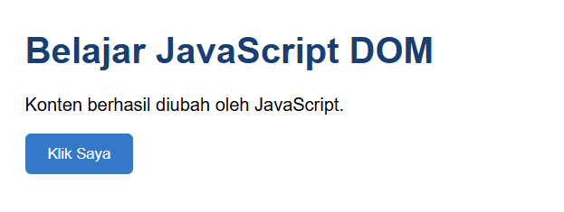
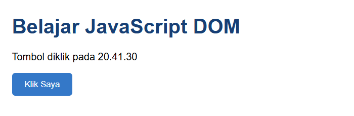

### 3. Latihan 3 - Mengubah Kelas dan Gaya CSS

Menggunakan `classList.toggle()` untuk menambahkan dan menghapus class CSS sehingga tampilan paragraf dapat berubah.

**Hasil Praktikum:**

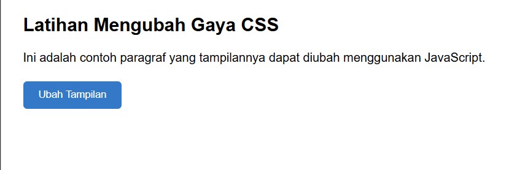
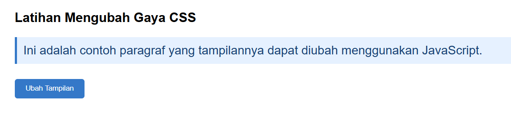

### 4. Latihan 4 - Event Input dan Penghitung Karakter

Menggunakan event `input` untuk menghitung jumlah karakter yang dimasukkan pengguna secara langsung.

**Hasil Praktikum:**

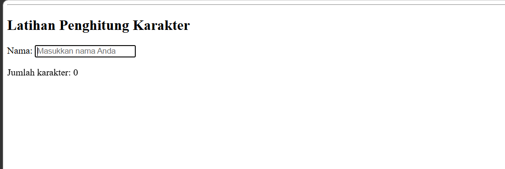
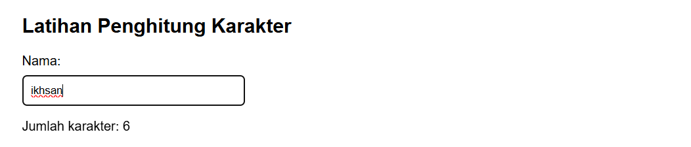

### 5. Latihan 5 - Validasi Form Pendaftaran

Membuat form pendaftaran yang terdiri dari nama lengkap, email, dan usia. Validasi dilakukan menggunakan JavaScript untuk memastikan data sesuai ketentuan.

**Hasil Praktikum:**

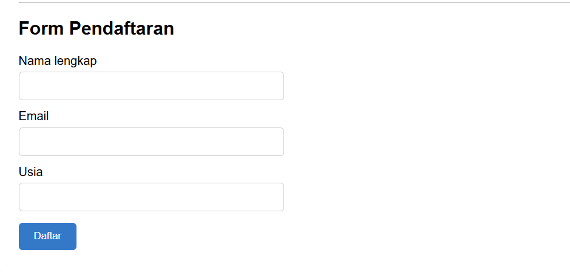

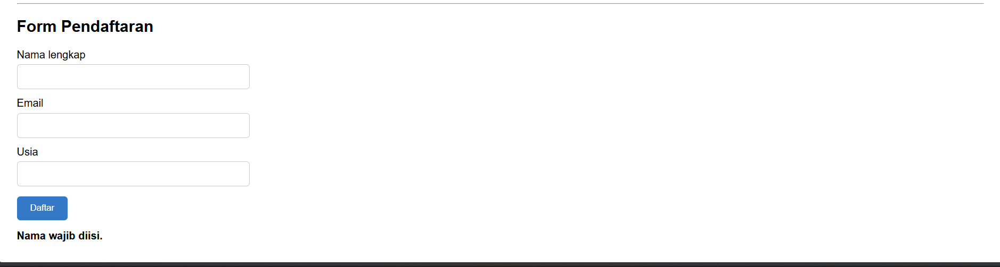


### 6. Latihan 6 - To-do List

Membuat aplikasi daftar tugas sederhana dengan fitur menambahkan tugas, menandai tugas selesai, dan menghapus tugas.

**Hasil Praktikum:**

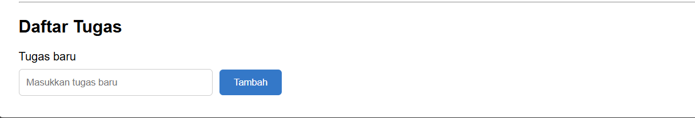

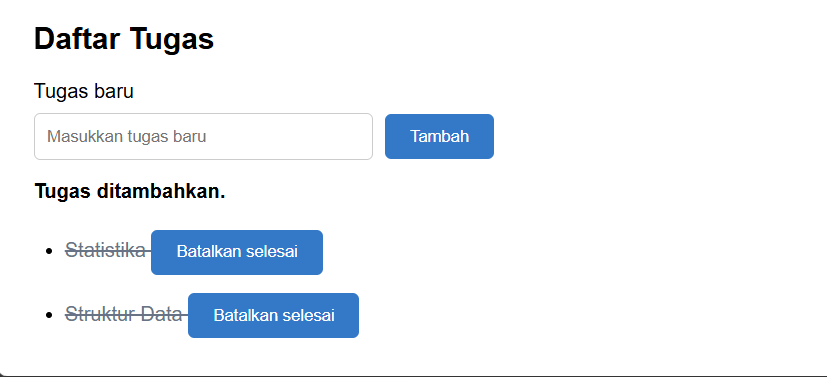

## E. Mini Project - Form Pendaftaran Workshop

Membuat halaman pendaftaran workshop dengan beberapa fitur interaktif, yaitu:

1. Validasi nama lengkap dan email.
2. Pilihan sesi workshop.
3. Penghitung karakter nama.
4. Menampilkan sesi yang dipilih.
5. Menampilkan pesan kesalahan dan keberhasilan.
6. Tombol reset untuk mengosongkan form.

**Hasil Mini Project:**

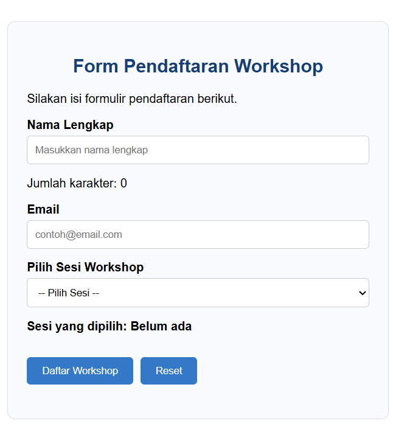
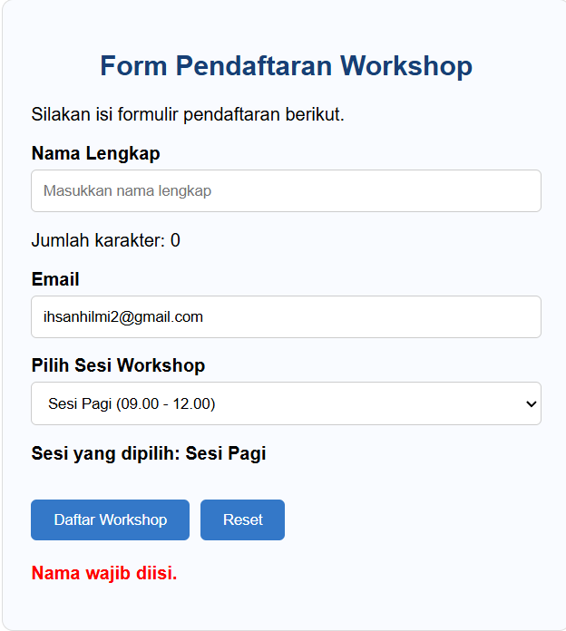
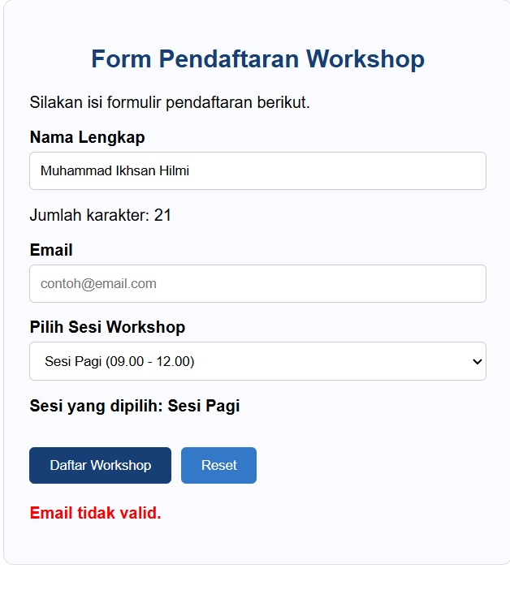
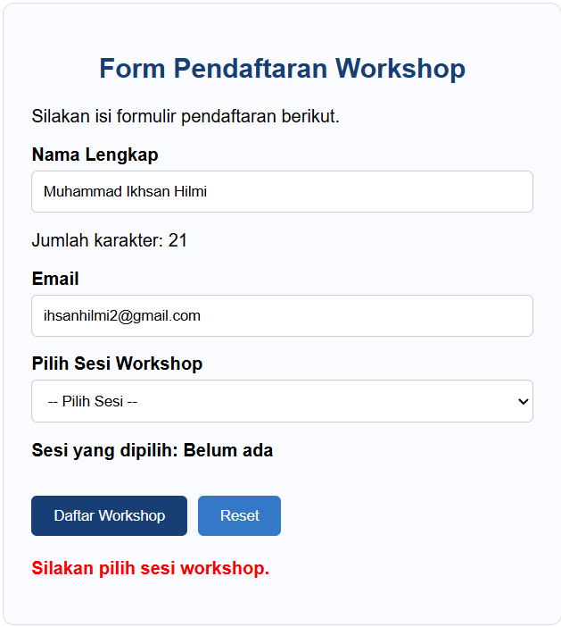
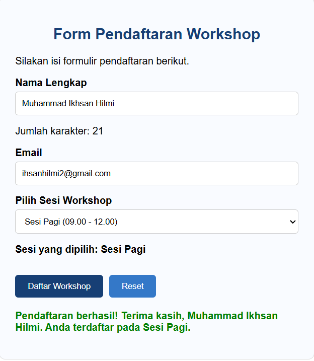
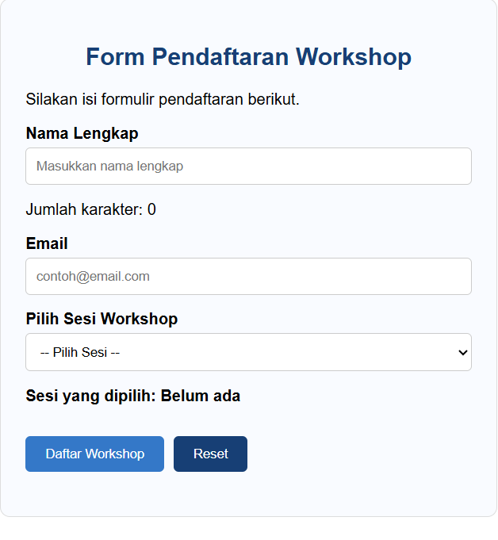

## F. Eksperimen Mandiri

Eksperimen mandiri dilakukan untuk mengembangkan pemahaman mengenai JavaScript DOM dan Event Handling.

1. **Eksperimen 1:** Menambahkan fitur untuk menghapus satu item dari To-do List.
2. **Eksperimen 2:** Mengubah validasi nama agar minimal terdiri dari tiga karakter.
3. **Eksperimen 3:** Menambahkan event `change` pada dropdown sesi workshop.
4. **Eksperimen 4:** Membuat tombol untuk menyembunyikan dan menampilkan paragraf menggunakan class CSS.
5. **Eksperimen 5:** Mengamati perbedaan penggunaan script dengan dan tanpa atribut `defer`.

**Hasil Eksperimen:**

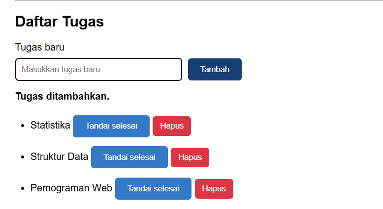

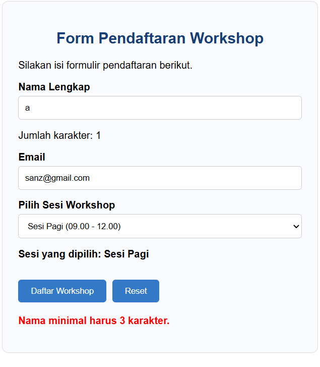
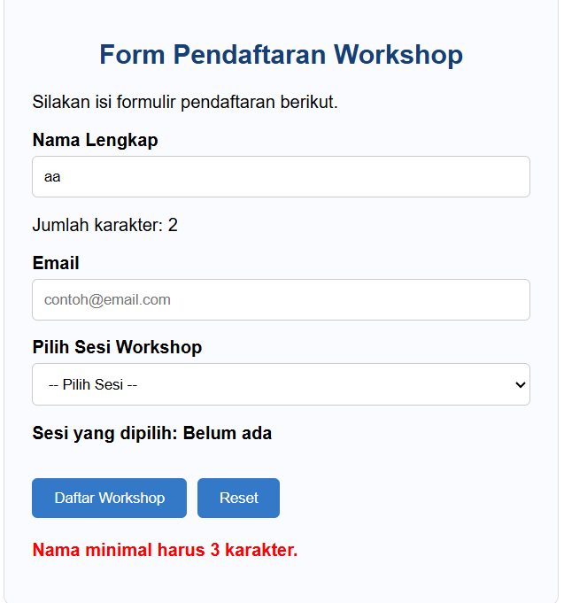
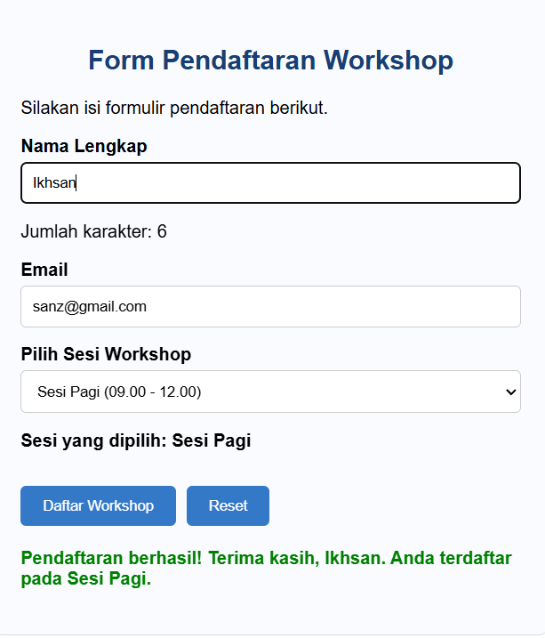

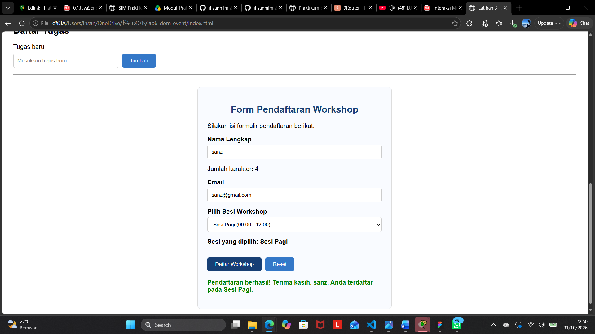
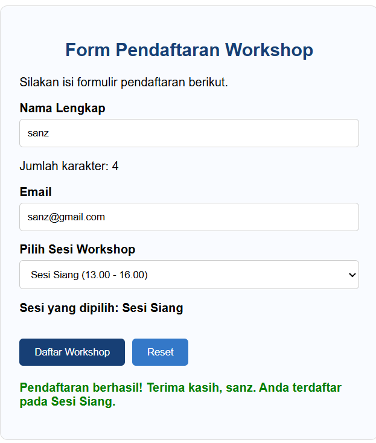
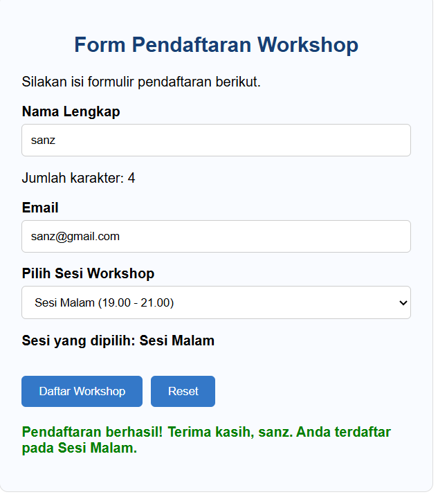

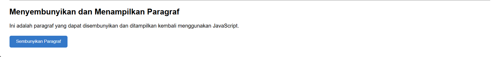
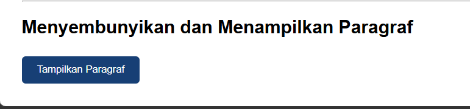

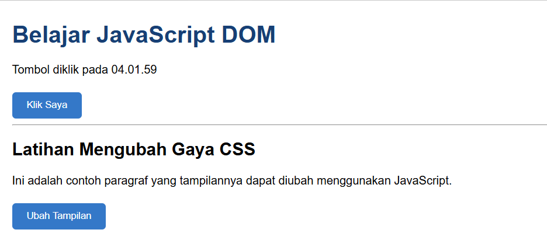
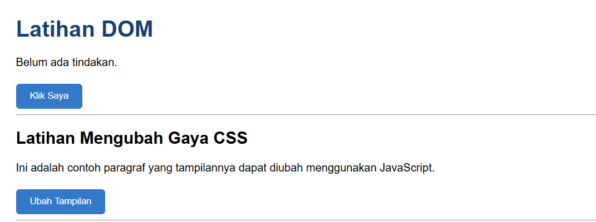

## G. Kesimpulan

Berdasarkan praktikum yang telah dilakukan, dapat disimpulkan bahwa JavaScript DOM memungkinkan pengembang untuk memanipulasi elemen HTML secara dinamis dan interaktif.

Melalui penggunaan `getElementById()`, `textContent`, `classList`, dan `addEventListener()`, halaman web dapat merespons berbagai tindakan pengguna.

Selain itu, penggunaan JavaScript juga memungkinkan pembuatan validasi form, penghitung karakter, serta aplikasi sederhana seperti To-do List dan Form Pendaftaran Workshop.

Praktikum ini memberikan pemahaman dasar mengenai penerapan JavaScript untuk membangun halaman web yang interaktif.

## H. Teknologi yang Digunakan

- HTML5
- CSS3
- JavaScript
- Visual Studio Code
- Web Browser

---

**Praktikum 6 - Pemrograman Web**  
**Topik: JavaScript DOM dan Event Handling**
